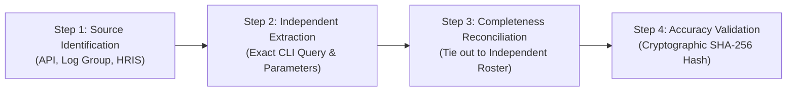
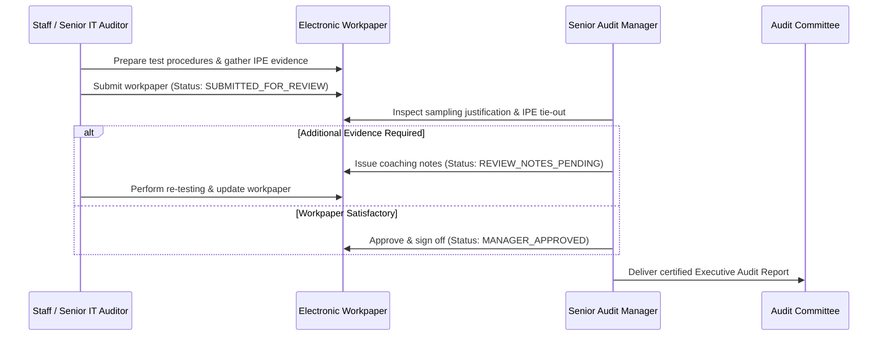

# Professional IT Internal Audit Standards & Methodology Guide

## Big Four IT Audit & Technology Risk Reference Architecture

This document articulates the professional audit methodology, regulatory frameworks, evidence standards, and supervisory review workflows implemented in the **AWS Cloud Infrastructure Security & Technology Risk Audit Platform**.

This implementation adheres to the **Institute of Internal Auditors (IIA) International Professional Practices Framework (IPPF)**, **ISACA Information Technology Assurance Framework (ITAF)**, and **PCAOB/AICPA Information Produced by the Entity (IPE)** guidance.

---

## 1. Distinguishing Automated Scanner Output from Audit Evidence

A fundamental distinction in professional IT audit practice is that **automated security scanners do not produce audit conclusions**:

| Dimension | Automated Security Scanner (CSPM / CLI Tool) | Professional IT Internal Audit (CISA / Big Four) |
| :--- | :--- | :--- |
| **Output Type** | Raw technical telemetry & configuration alerts | Independently validated, risk-calibrated audit workpaper |
| **Context Awareness** | Binary check (pass/fail) on isolated resource attributes | Evaluates architecture, defense-in-depth, and compensating controls |
| **Data Integrity** | Accepts query output as inherently true | Tests Information Produced by the Entity (IPE) for completeness and accuracy |
| **False-Positive Handling** | Emits alarms regardless of surrounding guardrails | Calibrates severity; documents rationale for technical overrides |
| **Supervisory Oversight** | Automated script execution | Two-tier supervisory review (Preparer -> Manager sign-off) |
| **Deliverable** | Raw finding list / vulnerability dump | Executive audit opinion, 5C structured findings, and management action plans |

---

## 2. Information Produced by the Entity (IPE) Testing Standard

Under **PCAOB Auditing Standard 1105 (Audit Evidence)** and **AICPA AU-C Section 500**, an auditor cannot rely on system-generated reports, configuration dumps, or database extracts without independently validating:

1. **Completeness:** Verifying that no in-scope resources or transactions were excluded from the population.
2. **Accuracy:** Verifying that data fields within the population faithfully represent reality and have not been altered.

### Four-Step IPE Verification Procedure



### Applied Examples from the Northstar Audit Workpapers:

#### A. IAM User Population Reconciliation (Test IAM-02)
- **Source System:** AWS IAM API (`iam:get_credential_report`) & Workday HRIS.
- **Completeness Tie-Out:** 14 active IAM users extracted via AWS CLI were reconciled 100% against the Workday Active Payroll Roster. Result: 12 active full-time employees, 2 authorized break-glass accounts, 0 unmapped or orphaned accounts.
- **Accuracy Verification:** SHA-256 hash calculated immediately upon API response download (`b7e4c1a...`). Directly sampled password last used attributes against CloudTrail login events.

#### B. Storage Bucket Population Reconciliation (Test DATA-01)
- **Source System:** AWS S3 Control & S3 API (`s3api:list_buckets`).
- **Completeness Tie-Out:** 4 buckets enumerated across account `112233445566` tied out against `aws_s3_bucket` resource declarations in Terraform state (`terraform.tfstate`).
- **Accuracy Verification:** Direct API queries executed for bucket ACL, Public Access Block, and bucket policy JSON.

---

## 3. Test of Design (TOD) vs. Test of Operating Effectiveness (TOE)

In accordance with AICPA SOC 2 and IIA standards, testing is formally bifurcated into:

### Test of Design (TOD)
- **Definition:** Evaluates whether controls, if operated as described by management, are properly designed to prevent or detect material technology risks and compliance deviations.
- **Timing:** Evaluated at a specific point in time (e.g., policy review, architectural pattern evaluation, Terraform module inspection).
- **Example:** Reviewing the company's Business Continuity Policy to verify that an annual database restore drill is mandated.

### Test of Operating Effectiveness (TOE)
- **Definition:** Evaluates whether controls functioned consistently throughout the entire audit period under review.
- **Timing:** Requires sampling populations over the 12-month period (e.g., inspecting 15 pull requests across four quarters, reviewing daily backup job logs over 30 days).
- **Example:** Inquiring for evidence that the annual database restore drill was actually executed during FY2026.

### Practical Demonstration of TOD vs. TOE Separation:

| Control ID | Control Title | TOD Conclusion | TOE Conclusion | Audit Interpretation |
| :--- | :--- | :--- | :--- | :--- |
| **CTL-IAM-02** | Console MFA Enforcement | **PASS** | **FAIL** | Policy exists requiring MFA for all interactive console users (Design effective); however, 1 developer identity was granted an emergency exception without an expiration date (Operating Effectiveness failed). |
| **CTL-DATA-01** | S3 Public Access Block | **PASS** | **FAIL** | Account-level PAB is active at the cloud boundary (Design effective); however, bucket-level defense-in-depth configuration was omitted on the archive bucket (Operating Effectiveness failed). |
| **CTL-BCP-03** | Annual DR Restore Testing | **PASS** | **FAIL** | Formal DR policy and runbooks exist (Design effective); however, management postponed the scheduled restore drill and failed to produce execution logs (Operating Effectiveness failed). |

---

## 4. Sampling Methodology & Population Determination

Sampling approaches comply with **IIA GTAG 3 (Continuous Auditing)** and **AICPA Audit Sampling Guidelines**:

```
+-----------------------------------+-----------------------------+-------------------------------+
| Control Frequency                 | Minimum Sample Size         | Sampling Method               |
+-----------------------------------+-----------------------------+-------------------------------+
| Continuous Automated              | 100% Automated Population   | Full population API scan      |
| Daily Execution                   | 25 - 30 items               | Random / Systematic           |
| Weekly Execution                  | 10 - 15 items               | Random                        |
| Monthly Execution                 | 2 - 5 items                 | Haphazard                     |
| Quarterly Execution               | 2 items (two quarters)      | Judgmental                    |
| Annual Execution                  | 1 item (the annual event)   | 100% Inspection               |
| Event-Driven (e.g. Pull Requests) | 15 - 25 items               | Risk-Based Judgmental         |
+-----------------------------------+-----------------------------+-------------------------------+
```

---

## 5. Calibrating Severity & Evaluating Compensating Controls

A key failure of amateur security dashboards is reporting every scanner alert as an imminent "Critical" breach. Big Four IT auditors evaluate **defense-in-depth** and **compensating controls**:

### False-Positive Elimination Scenarios:

1. **S3 Public Access Block:**
   - *Scanner Alert:* "CRITICAL - S3 bucket public policy not blocked."
   - *Compensating Control:* Account-level S3 Public Access Block is enabled with all four flags set to `true`.
   - *Audit Calibration:* The bucket cannot be reached from the public internet. The finding is calibrated down to **Significant Deficiency** (secondary defense-in-depth gap) rather than an imminent data breach.

2. **KMS Key Rotation:**
   - *Scanner Alert:* "HIGH - KMS key rotation disabled on asymmetric RSA key."
   - *Technical Calibration:* AWS KMS does not support automated rotation for asymmetric keys or imported key material by architectural design. The auditor marks this check **NOT_APPLICABLE** with documented technical rationale rather than generating a false finding.

3. **EC2 Inbound Port 22:**
   - *Scanner Alert:* "HIGH - Inbound port 22 permitted in security group."
   - *Technical Validation:* The auditor inspects whether an Elastic IP (public IPv4) is attached and whether an Internet Gateway route exists. If the instance resides in an isolated private subnet with no public IP, internet reachability is false.

---

## 6. Audit Finding Classification Standard

Audit exceptions are classified under formal internal audit categories:

1. **Material Weakness:**
   - A deficiency, or combination of deficiencies, in internal control such that there is a reasonable possibility that a material breach, severe data loss, or total service disruption will not be prevented or detected on a timely basis.
   - *Northstar Audit Result:* **0 Material Weaknesses**.

2. **Significant Deficiency:**
   - A deficiency, or combination of deficiencies, in internal control that is less severe than a material weakness yet important enough to merit attention by those charged with governance (Audit Committee, CISO).
   - *Northstar Audit Result:* **5 Significant Deficiencies** (CI/CD role wildcard permissions, un-MFA'd console user, S3 archive bucket PAB, S3 data-plane logging omission, absence of DR restore testing).

3. **Operational Control Deficiency:**
   - An isolated procedural lapse that does not pose an immediate enterprise threat but represents a divergence from organizational standards.
   - *Northstar Audit Result:* **2 Operational Deficiencies** (KMS annual key rotation disabled, programmatic access key >90 days).

---

## 7. Two-Tier Supervisory Review & Sign-Off Workflow

All workpapers in the platform enforce a formal two-tier sign-off protocol:



### Review Status Definitions:
- **DRAFT:** Workpaper is currently in preparation by the lead auditor; testing is underway.
- **SUBMITTED_FOR_REVIEW:** Fieldwork is complete; workpaper submitted for supervisory evaluation.
- **REVIEW_NOTES_PENDING:** The Audit Manager has identified gaps (e.g., missing sampling rationale or incomplete IPE reconciliation) that require auditor resolution before sign-off.
- **MANAGER_APPROVED:** The Audit Manager has reviewed and concurred with all conclusions, exceptions, and severity ratings.

